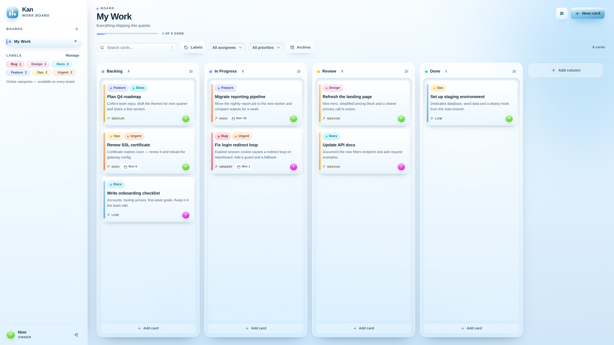
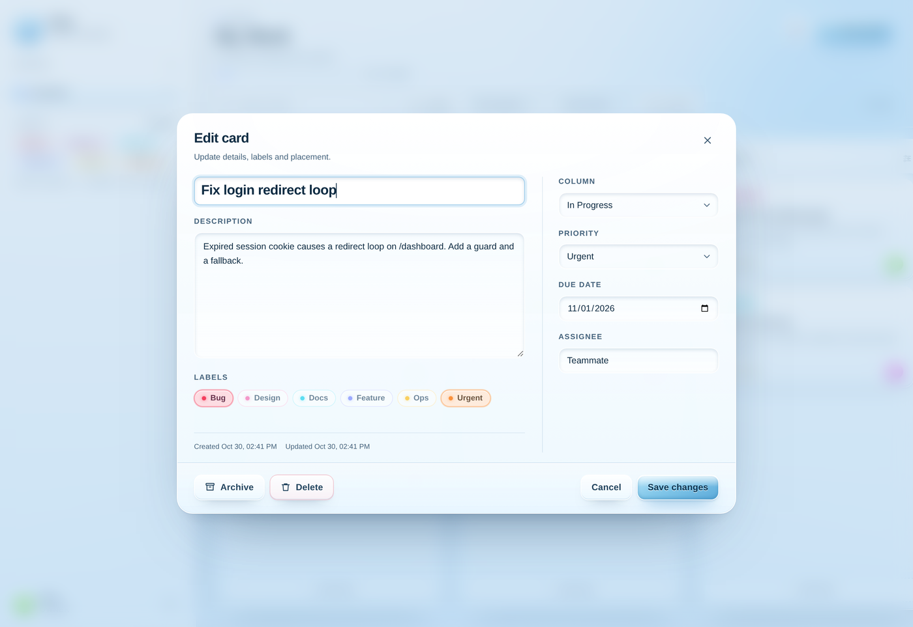
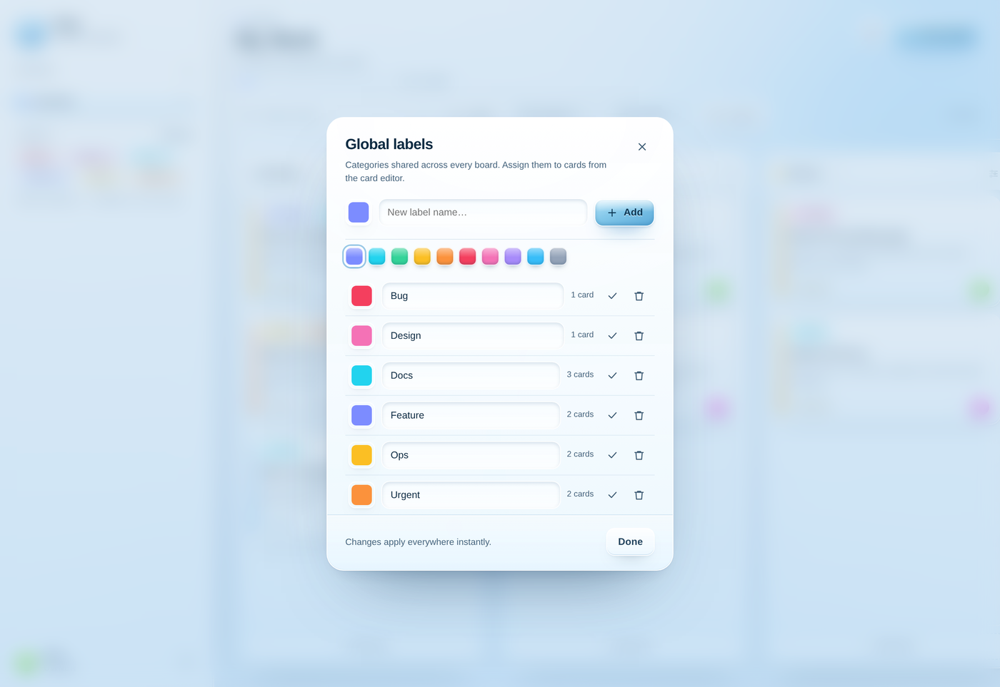
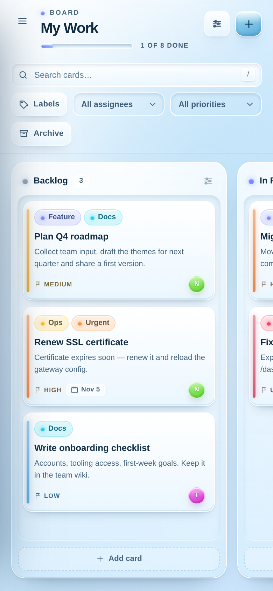
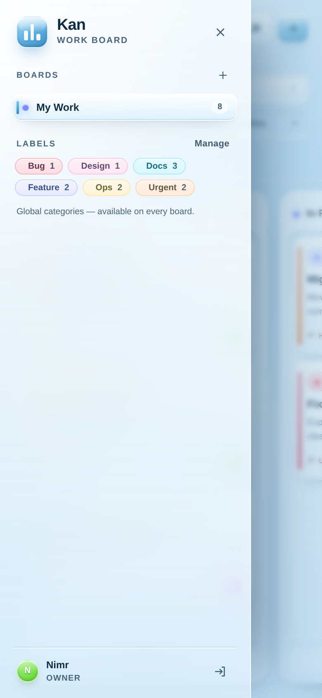
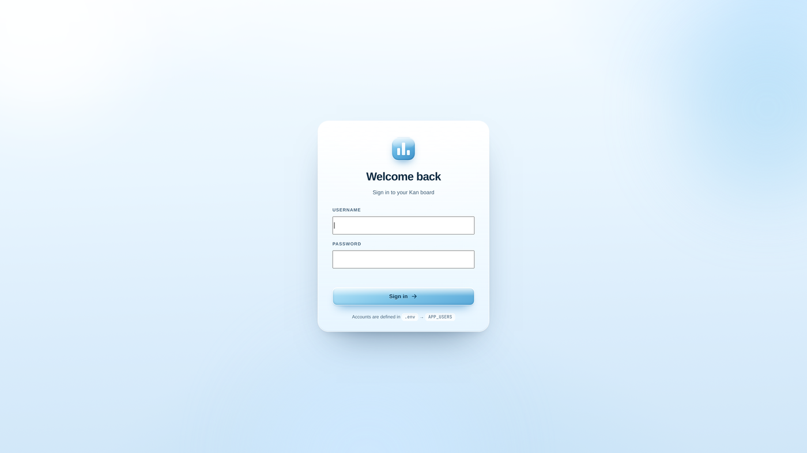

<div align="center">
  
  <h1>Kan</h1>
  <p><strong>A calm, self-hosted Kanban board for real work.</strong><br />
  Sky-blue glass, soft depth, zero build step.</p>

  <p>
    
    
    
    
    
  </p>

  <p>
    <a href="#quick-start"><strong>Quick start</strong></a> ·
    <a href="#features">Features</a> ·
    <a href="#screenshots">Screenshots</a> ·
    <a href="#configuration">Configuration</a> ·
    <a href="#api">API</a>
  </p>
</div>

<br />



## A board that feels calm

Most trackers get in the way. Kan is a single small app you run yourself: one board view, drag-and-drop
columns, cards that hold exactly what work needs (description, priority, due date, assignee, labels), and
nothing that nags you.

The interface is built around **Glacier Sky** — a light sky-blue glass theme with frosted panels, recessed
card wells, soft bevels and fluid gradients. It is fully responsive, keyboard-friendly, and respects
`prefers-reduced-motion`.

- **No build step.** Plain HTML, CSS and JavaScript on the front end. Edit a file, reload.
- **No registration.** Accounts are static entries in `.env`; sessions are signed `HttpOnly` cookies.
- **No external services.** The app and MariaDB run together with one `docker compose` command.
- **No lost work.** Card order, columns and labels persist in MariaDB; the data lives in a Docker volume.

## Features

| | |
| --- | --- |
| **Boards & columns** | Multiple boards, drag-and-drop cards within and across columns, quick add, archive and restore, live “done” progress. |
| **Global labels** | Categories are stored once and reused on every board. Create, rename, recolour, and see usage counts. |
| **Rich cards** | Description, priority, due date with overdue highlighting, assignee, labels, and per-card metadata. |
| **Filters** | Full-text search plus label, assignee and priority filters. Dragging pauses while filters are active so hidden cards are never reordered by accident. |
| **Column settings** | Colour, optional WIP limit (flags when exceeded) and “counts as done” for the progress bar. |
| **Static auth** | Accounts live in `.env`; 7-day signed sessions, `HttpOnly` cookies and login throttling. |
| **Glacier Sky UI** | Frosted glass, icy bevels, animated sky wash, accessible contrast throughout, and a mobile drawer. |
| **Docker-first** | One command runs the app and its MariaDB 11.4 database. Seed data is idempotent. |

## Screenshots

<table>
  <tr>
    <td width="50%" align="center"><br /><sub><b>Card editor</b> — everything about a piece of work in one place.</sub></td>
    <td width="50%" align="center"><br /><sub><b>Global labels</b> — define a category once, use it everywhere.</sub></td>
  </tr>
</table>

<table>
  <tr>
    <td width="50%" align="center"><br /><sub><b>Mobile board</b> — columns scroll sideways, nothing overflows.</sub></td>
    <td width="50%" align="center"><br /><sub><b>Sidebar drawer</b> — boards, labels and your account.</sub></td>
  </tr>
</table>

## Quick start

```bash
cd kan
docker compose up -d --build
```

Open **http://localhost:3000** and sign in.

| Username | Password | Role |
| --- | --- | --- |
| `nimr` | `kanban123` | Owner |
| `teammate` | `work123` | Member |

> [!IMPORTANT]
> Change these accounts and `SESSION_SECRET` in `.env` before putting the app on a network.

The first start creates the schema, six starter labels and a demo board with eight sample cards. Both the
schema and the seed are idempotent — restarting never duplicates data.

The stack:

| Service | Port | Notes |
| --- | --- | --- |
| `app` | `3000` | Node app — serves the UI and `/api` |
| `db` | `3307` (host) → `3306` | MariaDB 11.4, volume `kan_kan-db-data` |

<p align="center">
  <br />
  <sub>Sign-in is part of the same frozen-glass language.</sub>
</p>

## Local development

```bash
npm install
docker compose up -d db    # MariaDB only, exposed on 127.0.0.1:3307
npm run dev                # node --watch, app on http://localhost:3000
```

`npm start` runs it once without watch mode. Locally the app reads `.env` directly
(`DB_HOST=127.0.0.1`, `DB_PORT=3307`); inside Compose those values are overridden to reach the `db` service.

## Managing accounts

There is no user table and no sign-up. Accounts are static entries in `.env`:

```env
APP_USERS=[{"username":"you","name":"Your Name","password":"a-strong-password","role":"Owner"}]
```

- Usernames are case-insensitive.
- `name` is what appears on cards and in the sidebar.
- `role` is display-only (for example `Owner`, `Member`).
- Changing a password invalidates sessions issued under the old password.
- Remove an entry and restart to revoke that user’s access immediately.
- After editing `.env` in Docker, recreate the container: `docker compose up -d app`.

## Configuration

Everything lives in `.env` (see `.env.example` for a template):

| Variable | Default | Purpose |
| --- | --- | --- |
| `PORT` | `3000` | App port |
| `SESSION_SECRET` | – | HMAC key for session cookies. **Set a long random value.** |
| `SESSION_DAYS` | `7` | Cookie/session lifetime in days |
| `APP_USERS` | demo fallback | JSON array of static accounts |
| `DB_HOST` | `127.0.0.1` | MariaDB host |
| `DB_PORT` | `3307` | MariaDB port (`3307` on the host, `3306` inside Compose) |
| `DB_NAME` | `kan` | Database name |
| `DB_USER` | `kan` | Database user |
| `DB_PASSWORD` | `kan_secret` | Database password |
| `COOKIE_SECURE` | unset | Set to `1` behind HTTPS to add the `Secure` cookie flag |
| `APP_HOST_PORT` | `3000` | Compose-only host port for the app |
| `DB_HOST_PORT` | `3307` | Compose-only host port for the database |

The Compose MariaDB root password defaults to `root_secret`; override it with `MARIADB_ROOT_PASSWORD`.

## Global labels (categories)

Labels are stored globally in the `labels` table, not per board — that is the “category” concept:

- Add, rename, recolour or delete them from the sidebar → **Labels → Manage**.
- Assign them to any card from the card editor.
- Filter by one or more labels from the filter bar, or by clicking a chip in the sidebar.
- Deleting a label removes it from every card; boards and cards themselves are untouched.
- Usage counts show how many active cards use each label.

## Keyboard shortcuts

| Key | Action |
| --- | --- |
| `/` | Focus search |
| `n` | New card (when not typing) |
| `Esc` | Close modal / popover / mobile sidebar |
| `Ctrl` / `Cmd` + `Enter` | Save the open card |
| `Enter` | Submit quick add, or open a focused card |
| `Shift` + `Enter` | New line in quick add |

## Data & backups

The database lives in the `kan_kan-db-data` Docker volume.

```bash
# dump
docker compose exec db mariadb-dump -u kan -pkan_secret kan > kan-backup.sql

# restore
cat kan-backup.sql | docker compose exec -T db mariadb -u kan -pkan_secret kan
```

To wipe everything and start from a fresh seed:

```bash
docker compose down -v
docker compose up -d --build
```

## Project layout

```
kan/
├─ server/
│  ├─ index.js      Express bootstrap, static files, graceful shutdown
│  ├─ config.js     .env parsing, static accounts
│  ├─ auth.js       HMAC session cookie, password checks, auth middleware
│  ├─ db.js         MariaDB pool, schema creation, startup retry
│  ├─ seed.js       idempotent demo data
│  └─ api.js        REST API (boards, columns, cards, ordering, labels)
├─ public/
│  ├─ index.html    shell + login
│  ├─ styles.css    Glacier Sky glass theme, responsive layout
│  └─ app.js        rendering, drag & drop, modals, filters, auth
├─ docs/            README screenshots + logo
├─ docker-compose.yml
├─ Dockerfile
└─ .env / .env.example
```

## API

All routes live under `/api`; a session cookie is required except for `login` and `health`.

```
POST   /auth/login        POST /auth/logout        GET /auth/me
GET    /health
GET    /meta              GET  /boards             POST /boards
GET    /boards/:id        PATCH/DELETE /boards/:id
POST   /boards/:id/columns
POST   /boards/:id/order  (persist column/card ordering after drag & drop)
PATCH/DELETE /columns/:id
POST   /cards             PATCH/DELETE /cards/:id
GET    /labels            POST /labels             PATCH/DELETE /labels/:id
```

## Before exposing it

- Put a reverse proxy (Caddy, nginx, Traefik) in front, enable HTTPS, then set `COOKIE_SECURE=1`.
- Change `SESSION_SECRET`, the demo passwords and the database credentials.
- The app binds `0.0.0.0:3000`; the database is published only on `127.0.0.1:3307` by default.
- Sessions cannot be revoked individually (static auth); changing a password or removing an account
  invalidates them.

<div align="center"><sub>Built for small teams who would rather ship than configure.</sub></div>
